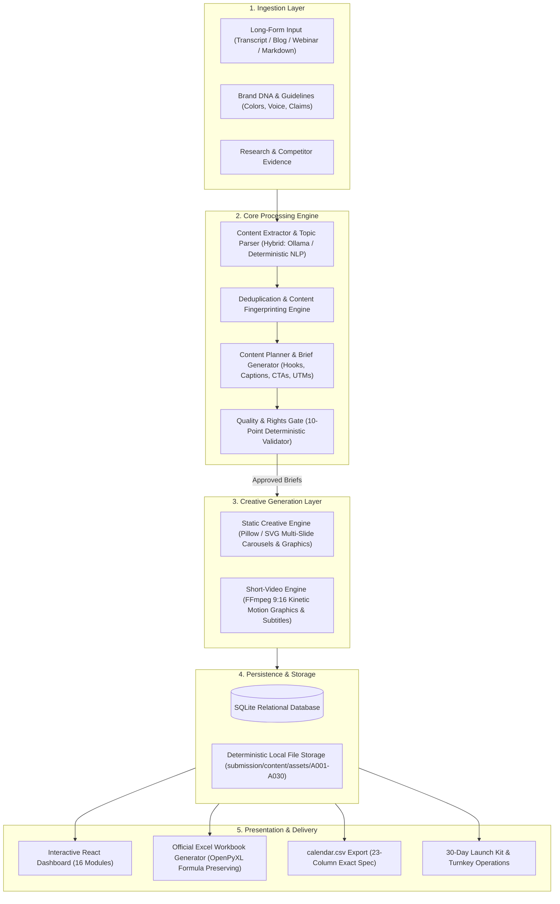

# System Architecture — AI Social Media Marketing and Content Engine

## 1. High-Level Architecture Overview

The system is built as a modular, decoupled full-stack application with a dual execution interface:
1. **Interactive Full-Stack Web Dashboard:** FastAPI backend serving REST endpoints paired with a responsive modern React/TypeScript UI for visual campaign management, brief review, asset inspection, quality audits, and manual overrides.
2. **Deterministic High-Throughput CLI Engine:** Fast command-line interface capable of running automated batch ingestions, repeat runs, refresh updates, benchmarks, and submission exports in under 5 minutes with zero external dependencies.

---

## 2. The 16 Application Modules

| Module # | Module Name | Description & Key Responsibilities |
|---|---|---|
| **01** | **Dashboard** | Mission control overview: brand selection, campaign KPIs, ready vs. draft counts, format breakdown, and engine execution status. |
| **02** | **Brand Workspace** | Central management of brand parameters: mission, target creator audience, colors (`#4F46E5`, `#06B6D4`, `#10B981`), typography, approved/forbidden claims. |
| **03** | **Brand DNA** | Extracted brand profile linking verified product features to source evidence while explicitly tagging assumptions. |
| **04** | **Product & Market Research** | Stores the 5 product observations, 3 social opportunities, and real account audits (IncuBrix + 5 competitors: OpusClip, Riverside, Buffer, Descript, VEED). |
| **05** | **Strategy Builder** | Defines creator personas (Solo Podcaster, YouTube Educator, Content Team Lead), 3 chosen platforms (LinkedIn, Instagram, YouTube Shorts), 5 content pillars, brand voice, and the social-to-signup conversion funnel. |
| **06** | **Input Ingestion** | Handles document uploads, raw text, and markdown transcripts; computes SHA256 hashes and extracts structural lessons/quotes. |
| **07** | **Content Planner** | Synthesizes platform-native hooks, value-dense educational copy, hashtags, CTAs, UTM tracking parameters, and proposed publishing calendar slots. |
| **08** | **Creative Brief Approval** | Human-in-the-loop review interface allowing users to inspect, edit, approve, or reject creative briefs prior to heavy media rendering. |
| **09** | **Static Creative Generator** | Pillow and SVG rendering engine producing 1080x1350 multi-slide educational carousels and 1080x1080 promotional graphics with editable project files. |
| **10** | **Short-Video Generator** | FFmpeg motion graphics engine creating <=60s 9:16 vertical videos featuring 2-second visual hooks, kinetic captions, synced voiceovers, progress bars, and branded end-cards. |
| **11** | **Quality & Rights Gate** | Deterministic 10-point audit engine evaluating every asset against platform dimensions, duration, copy completeness, UTM links, rights safety, and AI labeling. Blocks `Ready` status on failure. |
| **12** | **Asset Library** | Filterable, searchable repository of all generated assets displaying final rendered outputs (MP4/PNG), editable source files (SVG/JSON), and full metadata. |
| **13** | **Interactive Calendar** | 30-day interactive scheduling view with daily time slots and one-click export to official 23-column `calendar.csv`. |
| **14** | **Audience Test Manager** | Protocol and test harness for the 20-person creator preference test, capturing anonymized responses, computing preference rates, and comparing against industry benchmarks. |
| **15** | **Run History & Telemetry** | Execution logging recording input size, items produced/rejected, duplicates pruned, runtime seconds, direct cost (₹0), and failure recovery events. |
| **16** | **Submission Center** | One-click submission bundler generating the completed Excel workbook (`completed_submission_workbook.xlsx`), full folder tree, launch kit, and live review tracer. |

---

## 3. Data Flow & Deduplication Logic

1. **Fingerprint Computation:** For each candidate asset, a composite hash is generated from:  
   `fingerprint = sha256(platform + ":" + format + ":" + pillar + ":" + normalized_hook)`
2. **Duplicate Detection:** If the fingerprint matches an existing approved or published asset in the database, the candidate is flagged as `DUPLICATE` and discarded during re-runs.
3. **Refresh Behavior:** When a new long-form input is provided, the engine extracts novel topics, generates fresh assets, and appends them to the campaign without altering previously approved or scheduled assets.
4. **Workbook Formula Alignment:** Assets are exported to the workbook with exact row mappings so that formulas in column V (`duplicate_check`) and column W (`completeness_check`) calculate to `UNIQUE` and `COMPLETE`.
