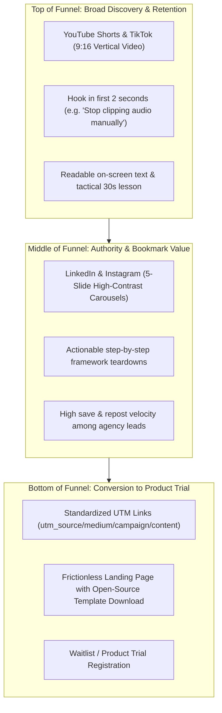

# Comprehensive Social Growth Strategy — IncuBrix 2027

**Assessment Area:** Content and Strategy Quality (35 Points)  
**Target Market:** United States, Canada, United Kingdom, Ireland, Australia, New Zealand, Singapore  
**Core Target Audience:** Video Podcasters, YouTube Educators, and Boutique Content Operations Teams

---

## 1. Executive Positioning & Value Proposition

IncuBrix positions itself as the **Zero-Cost, Local-First Content Engine for Modern Creators**.  
While competitors (OpusClip, Descript, Munch) charge recurring cloud subscription fees ($30–$80/mo) and process private media on remote servers, IncuBrix enables creators to transform one long-form recording (podcast, webinar, or tutorial) into a full week of platform-native, brand-checked social assets directly on their own computer with **₹0 direct software cost**.

---

## 2. The Social-to-Signup Conversion Funnel

1. **Top of Funnel (Attract):** Short-form 9:16 vertical videos (YouTube Shorts and Instagram Reels) generate algorithmic discovery. The opening 2-second hook immediately calls out creator production fatigue and demonstrates a concrete solution.
2. **Middle of Funnel (Educate & Prove):** Multi-slide carousels and single-graphic takeaways on LinkedIn and Instagram establish technical credibility. High-density frameworks incentivize bookmark saves and professional reposts.
3. **Bottom of Funnel (Convert):** Every asset embeds a dedicated UTM parameter (`utm_campaign=growth_engine_2027&utm_content=A001-A030`). Calls-to-action drive to live destinations: walkthrough bookings at incubrix.com/contact and the open-source engine repository, rather than generic sales pitches. Note: incubrix.com has no dedicated signup page today, so /contact is the conversion endpoint until IncuBrix ships a campaign landing page.

---

## 3. Four Core Content Pillars

1. **Workflow Systems & Repurposing (30% Target Share):** Actionable, repeatable frameworks turning 1 long recording into 10 multi-platform assets without manual clipping.
2. **Creator Growth & Retention Science (25% Target Share):** Hook formulas, thumbnail psychology, retention drop-off teardowns, and algorithm changes.
3. **Zero-Cost Production Hacks (20% Target Share):** Running local AI models, FFmpeg command recipes, audio mastering tricks, and zero-subscription creator stacks.
4. **Asset Teardowns & Before/Afters (15% Target Share):** Side-by-side critiques of real creator posts, showing how re-hooking and visual pacing doubles engagement.
5. **Engineering Proof & Transparency (10% Target Share):** Real performance benchmarks, memory optimizations, open code snippets, and honest retrospective lessons.

---

## 4. Measurable 30-Day Growth Targets

| Metric | 30-Day Baseline (Current) | 30-Day Growth Target | Measurement Method |
|---|---|---|---|
| **Total Organic Impressions** | <1,500 impressions/mo | **45,000+ impressions** | Platform native analytics (YouTube Studio, LinkedIn Page Analytics, Meta Insights) |
| **Average Engagement Rate** | ~0.8% | **>= 2.8%** | Total engagements (Likes + Comments + Reposts + Saves) / Impressions |
| **Tracked Link Clicks** | Near zero | **350+ qualified clicks** | Google Analytics / Server-side UTM event tracking |
| **Product Waitlist / Trials** | 0 | **40+ creator sign-ups** | Conversion tracking via UTM attribution on sign-up flow |
